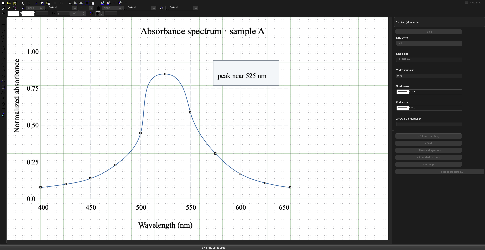

# TpX: drawing tool for TeX

This is the continuation of the TpX project that has been ported 
to the cross-platform Lazarus environment for Windows/Mac/Linux.

TpX is a lightweight, easy-to-use graphical editor for creating drawings and including them 
into LaTeX files in publication-ready form. It can also be used as a stand-alone editor for 
vector graphics. Up to version 1.5 it has been developed by Alexander Tsyplakov.

## Download and install

[Download TpX 1.6.0](https://github.com/krystophny/tpx/releases/tag/v1.6.0)
for Windows x86-64, Linux x86-64 or Apple Silicon macOS. Extract the archive and
run the editor; no compiler is needed. See [INSTALL.md](INSTALL.md) for the
short installation steps, dependencies and Mac first-launch instructions.
The Mac app is ad hoc signed and not notarized.

TpX 1.6.0 predates opening and saving TikZ and SVG sources, the Inspector and
**File → Open Example**; the browser build and the guide below follow the
current `master`. With the default `tikz` TeX format, a 1.6.0 `.TpX` file
carries its TikZ picture after the editor data, so include the saved drawing
directly with `\input{figure.TpX}`.

To try TpX without installing it, open the
[browser build](https://krystophny.github.io/tpx/). It is deployed from the
latest `master` and runs on the Lazarus CustomDrawn WASI backend proposed in
[Lazarus MR !813](https://gitlab.com/freepascal.org/lazarus/lazarus/-/merge_requests/813).

### Preferences and recovery files

TpX keeps preferences, recovery drafts and preview caches in your user profile,
separate from the application and drawing files. Windows uses
`%APPDATA%\TpX\TpX.ini` for preferences, `%LOCALAPPDATA%\TpX\AutoSaveRecovery`
for recovery drafts and `%LOCALAPPDATA%\TpX\preview-cache` for the preview
cache. Linux uses the XDG config, state and cache directories, with `~/.config`,
`~/.local/state` and `~/.cache` as fallbacks. macOS uses
`~/Library/Preferences/TpX/TpX.ini`,
`~/Library/Application Support/TpX/AutoSaveRecovery` and
`~/Library/Caches/TpX/preview-cache`.
Existing per-user preferences take precedence. If there are none, TpX imports
the historical `TpX.ini` from beside the executable or the previous macOS
settings location and leaves the original in place.

For a self-contained copy, start TpX with `--portable` or place an empty
`TpX.portable` file beside the executable. TpX then stores files under
`TpX-portable-data/{config,state,cache}` beside that copy. For a macOS app,
place the sentinel beside `TpX.app`; portable data stays beside the bundle so
the signed app resources remain intact. **Help → Storage locations** shows the
paths in use.

[](https://github.com/krystophny/tpx/actions/workflows/test.yml)

## First scientific figure

The desktop **File → Open Example** menu opens three bundled drawings as new
unsaved documents, so **Save** asks where to write your copy. In the browser,
download the [quadratic function](examples/quadratic-function.TpX),
[vector addition](examples/vector-addition.TpX), or
[double-slit](examples/double-slit.TpX) example, then choose **File → Open**.
Choose **File → Download a copy** to keep browser edits outside the current
tab. The examples use native vector objects and TeX labels; they have no linked
image assets.

To build a figure from a blank page:

1. Choose **File → New**. Draw axes with **Insert → Insert line**, then use
   **Insert → Insert curve** for a plotted trace; click to place its points and
   double-click to finish.
2. Add a label with **Insert → Insert text**. Select it to edit its caption and
   **TeX source**; for example, enter `$f(x)=x^2-1$` as the TeX source. The
   caption remains editable on the canvas.
3. Select an object to inspect its style and text properties in the
   **Inspector**. Choose **Point coordinates…** for point geometry;
   **Object properties** focuses the Inspector on the selection.

   

   The Inspector stays beside the drawing, so edits can be checked against the
   figure as you work.

4. Choose **File → Save as…** (**File → Download a copy as…** in the browser),
   select **TikZ source**, and save `figure.tikz`.
   Keep the `.TpX` file for native editing; TikZ save-back supports a defined
   subset and refuses edits it cannot represent safely.
5. Include the TikZ snippet in LaTeX:

   ```tex
   \usepackage{tikz}
   ...
   \input{figure.tikz}
   ```

   Compile with `pdflatex`. Debian/Ubuntu need `texlive-latex-base` and
   `texlive-pictures` for the engine and PGF/TikZ. The snippet carries a
   bounding rectangle based on the figure's drawing extent.

Imported or refreshed TeX source stays inert until **View → Trust TeX preview
for this document** is chosen. Review the source first: desktop previews pass
it to the local LaTeX and `dvipng` tools; installing `dvisvgm` enables reusable
SVG previews. The browser uses bundled MathJax for supported math text and
does not run a local TeX engine or external programs. TikZ import is bounded
to 4 MiB, 500,000 tokens, and 256 nested groups.

Browser documents live in a temporary virtual file system for the current
tab. **File → Open** copies the selected file into that space, and **File →
Download a copy** downloads a copy; closing or reloading the tab discards
unsaved browser edits.
See [INSTALL.md](INSTALL.md) for platform setup.

Basic 3D objects (box, cylinder, sphere, cone, torus, extrusions and
revolutions) are described in [doc/basic-3d.md](doc/basic-3d.md).

## Build and run on Linux

TpX uses Free Pascal, Lazarus, the Lazarus Components Library (LCL), and the
`Printer4Lazarus` package included with Lazarus. GTK2 is the default Linux
backend. Building requires GNU Make and the GTK2 development libraries.

On Debian or Ubuntu:

```sh
sudo apt update
sudo apt install git make lazarus lcl-gtk2 fp-compiler fp-units-gfx libgtk2.0-dev
```

On Arch Linux or CachyOS:

```sh
sudo pacman -S --needed git make fpc lazarus gtk2
```

Clone, build, and start the editor:

```sh
git clone https://github.com/krystophny/tpx.git
cd tpx
make
make run
```

`make build` also builds the editor. The executable is
`obj/<cpu>-<os>/TpX`, for example `obj/x86_64-linux/TpX`.
An X11 display or XWayland is required to run the GTK2 editor.
The build stores its Lazarus configuration in the ignored `.lazarus/` directory.

The Makefile detects Lazarus in `/usr/lib/lazarus` or `/usr/share/lazarus`,
including versioned subdirectories used by Debian and Ubuntu.
For another installation location, pass the directory containing `lcl/`:

```sh
make LAZARUS_DIR=/path/to/lazarus
```

To build directly with Lazarus, use `lazbuild --ws=gtk2 TpX.lpi`.
If it reports that the Lazarus directory is invalid, add
`--lazarusdir=/path/to/lazarus`. Open `TpX.lpi` in the Lazarus IDE to develop
or debug the editor. Additional build flags can be passed through
`LAZBUILD_FLAGS`, for example `make LAZBUILD_FLAGS=--build-all`.

With Python 3 installed, run `make test` to check saved-drawing round trips
and SVG geometry. On a machine without a display, install Xvfb and use
`xvfb-run -a make test`. These checks also run in GitHub Actions on Linux.

### TeX and import/export tools

The editor can build and run without TeX. Previewing drawings and exporting
through LaTeX require `latex`, `pdflatex`, `dvips`, and the drawing packages.
Ghostscript (`gs`) supports PostScript conversion and previews, `mpost` supports
MetaPost output, and `pstoedit` supports PostScript/PDF import.

If Ghostscript, LaTeX or dvips is missing when a preview or export needs it,
TpX shows the required tool and an installation command or download link.
You can copy the command or open TpX settings to select an executable.
TpX also searches PATH and common installation directories when a saved path
is no longer valid. Command-line exports report missing tools on stderr and
return a nonzero exit status.

On Debian or Ubuntu:

```sh
sudo apt install texlive-latex-base texlive-latex-recommended texlive-latex-extra \
  texlive-pictures texlive-pstricks texlive-metapost ghostscript pstoedit
```

On Arch Linux or CachyOS:

```sh
sudo pacman -S --needed texlive-latex texlive-latexrecommended texlive-latexextra \
  texlive-pictures texlive-pstricks texlive-metapost ghostscript pstoedit
```

Bitmap-to-EPS conversion uses `sam2p` by default. Install it from your
distribution when available, or follow the [sam2p build instructions](https://github.com/pts/sam2p).
Without it, TpX writes bitmaps into EPS and PostScript output as uncompressed
image data, which works but produces larger files.
Its PNG, JPEG, and TIFF readers use Netpbm and libjpeg tools. Those are provided
by `netpbm` and `libjpeg-turbo-progs` on Debian/Ubuntu, or `netpbm` and
`libjpeg-turbo` on Arch/CachyOS. In TpX's settings, check the tool paths and
choose the viewers used to open previews.

### Drawing and TikZ defaults

Sized shapes support both dragging and click-to-click placement. In the Edit
menu, **Snap to shapes** attracts points to visible endpoints and corners
within six screen pixels. Shape snapping takes priority over grid snapping;
points farther away still use the grid when it is enabled.

Text can be selected across its visible area. Text properties offer left,
center, and right alignment. Enter a complete math expression such as
`$(a+b)$` in the text field, or use the **TeX source** field for other LaTeX code.
Choose the Text tool and click the canvas to type at a new label's position;
click an existing label with that tool or double-click it in selection mode to
edit it. With a text label selected, **Edit → Edit text** also opens the
canvas editor. Enter inserts a line break, while
Ctrl+Enter (or Command+Enter on macOS), Tab, or **Done** finishes the edit.
Escape cancels the uncommitted edit after any active input-method composition
ends.

Use **Edit → Object properties** to open the Object Inspector on the right;
**View → Object inspector** toggles it, and its splitter can be dragged to
resize the panel. Collapse a section to make room for the drawing. When a
selection contains different values for a field, the Inspector shows **Mixed**;
editing that field applies only that property to the selected objects and
preserves their other individual values. Coordinates, transforms, scale and
preferences keep their dedicated dialogs. File pickers and explicit
discard/replacement confirmations remain dialogs as well.

For a short desktop workflow check, draw a line and rectangle, create a canvas
label, change line width and text height in the Inspector, and edit the label's
TeX source in place. Use Tab, undo/redo, resize or collapse the Inspector, then
save and reopen; check that the geometry, anchor, Text and TeX source remain.
Desktop live previews typeset TeX text in the canvas using LaTeX and `dvipng`,
with reusable SVG output when `dvisvgm` is available. **View → Live LaTeX
Preview** toggles this behavior; it is enabled by default. Without the tools,
the canvas shows editable text. Explicit LaTeX previews and exports still work
as before.

On native desktop builds, **File → Automatic refresh → Auto refresh** is on by
default for source formats TpX can safely edit and save back. Pause refresh for
the current drawing or choose **Reload from disk…** to reload explicitly. If
external changes arrive while the drawing has unsaved edits, TpX keeps the
local scene and offers **Keep local edits** or **Save local copy…**; malformed
external files leave the current scene unchanged. Imported or refreshed TeX
content stays inert until **View → Trust TeX preview for this document** is
chosen. Trust applies only to the current document; opening another file,
reloading changed source, or restoring a recovery draft asks again. Approving
preview allows the configured local TeX tools to process its labels, so approve
only source you trust. Browser builds open and save supported SVG and TikZ
sources, but each file is a temporary snapshot: use **File → Open** again to
import external changes.

TikZ output supplies drawing defaults for `\tpxLineWidth`, `\tpxTextSize`,
`\tpxDashSize`, and `\tpxDotSize`. Define these before including the drawing
to override them, for example:

```tex
\newcommand{\tpxLineWidth}{0.4mm}
\newcommand{\tpxTextSize}{10pt}
\input{drawing.TpX}
```

Object-specific widths and text heights remain proportional to these defaults.
Unset defaults belong to the drawing's local group and do not affect later
figures. Disable `FontSizeInTeX` to inherit the document's font size instead.

Opened TikZ source saves back by patching supported edits into the original
source, preserving untouched text, comments, and whitespace. TpX rejects edits
whose meaning cannot be represented safely in the source. Native `.tpx` files
retain TpX editor data; TikZ save-back preserves supported drawing semantics
and source text, not TpX-only grouping or other editor metadata.

### Cropped LaTeX export

Export **PdfLaTeX source** and run `pdflatex` on the generated `.tex` file to
produce a PDF cropped to the drawing, including its configured border. This
uses the `preview` package supplied by the TeX prerequisites above. Exported
assets omit figure placement, centering, captions, and labels; those settings
remain in the editable drawing. Interactive document previews keep their
existing page layout.

**PDF from LaTeX EPS** also produces a cropped PDF and supports math text.

## Build and run on macOS

The Cocoa build was tested on Apple Silicon with Lazarus 4.8 and Free Pascal
3.2.3 from the upstream `fixes_3_2` branch. The older Homebrew FPC 3.2.2
compiler can fail with current Xcode linkers on Objective-C method atoms.
Install Xcode command-line tools and the bootstrap compiler:

```sh
xcode-select --install
brew install fpc git make python texlive ghostscript pstoedit
```

Build the maintained compiler in a private prefix:

```sh
git clone --depth 1 --branch fixes_3_2 https://gitlab.com/freepascal.org/fpc/source.git ~/code/fpc-source
cd ~/code/fpc-source
tpx_sdk=$(xcrun --sdk macosx --show-sdk-path)
make -j8 all FPC=/opt/homebrew/bin/fpc OPT="-XR$tpx_sdk" FPMAKE_BUILD_OPT="-XR$tpx_sdk"
make install INSTALL_PREFIX="$HOME/.local/tpx-fpc"
"$HOME/.local/tpx-fpc/bin/fpcmkcfg" \
  -d basepath="$HOME/.local/tpx-fpc/lib/fpc/3.2.3" \
  -d sharepath="$HOME/.local/tpx-fpc/share/fpc/3.2.3" \
  -o "$HOME/.local/tpx-fpc/etc/fpc.cfg"
ln -s ../lib/fpc/3.2.3/ppca64 "$HOME/.local/tpx-fpc/bin/ppca64"
export PATH="$HOME/.local/tpx-fpc/bin:/opt/homebrew/bin:$PATH"
export PPC_CONFIG_PATH="$HOME/.local/tpx-fpc/etc"
```

Then build Lazarus and TpX using that compiler:

```sh
git clone --depth 1 --branch lazarus_4_8 https://gitlab.com/freepascal.org/lazarus/lazarus.git ~/code/lazarus
cd ~/code/lazarus
# Apply the provider repairs used by the published binaries.
git apply ~/code/tpx/ci/patches/lazarus-4.8-opendocument.patch
git apply ~/code/tpx/ci/patches/lazarus-4.8-cocoa-font-cancel.patch
git apply ~/code/tpx/ci/patches/lazarus-4.8-cocoa-text-shortcuts.patch
git apply ~/code/tpx/ci/patches/lazarus-4.8-gtk2-text-composition.patch
git apply ~/code/tpx/ci/patches/lazarus-4.8-cocoa-focus-handoff.patch
make lazbuild LCL_PLATFORM=cocoa CPU_TARGET=aarch64 FPC="$HOME/.local/tpx-fpc/bin/fpc"
cd ~/code/tpx
make test WIDGETSET=cocoa LAZBUILD="$HOME/code/lazarus/lazbuild" \
  LAZARUS_DIR="$HOME/code/lazarus" LAZARUS_CONFIG="$PWD/.lazarus" \
  LAZBUILD_FLAGS="--compiler=$HOME/.local/tpx-fpc/lib/fpc/3.2.3/ppca64"
./obj/aarch64-darwin/TpX
```

The native GUI tests require a logged-in graphical session. Tool paths in
TpX's settings use Unix executable names on macOS, such as `pdflatex` and `gs`.

## Links
* http://tpx.sourceforge.net/
* https://sourceforge.net/projects/tpx/
* https://ctan.org/pkg/tpx?lang=de
