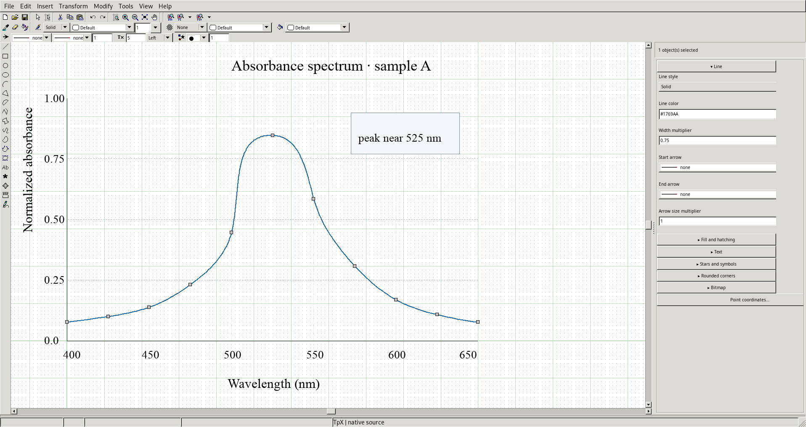
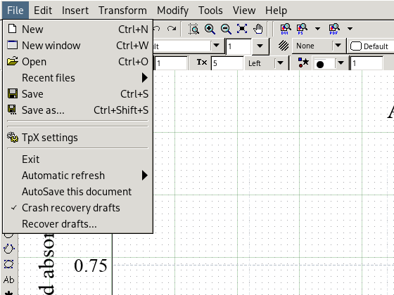
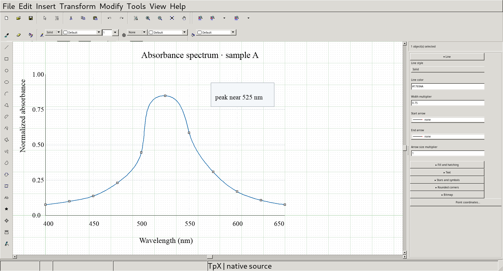
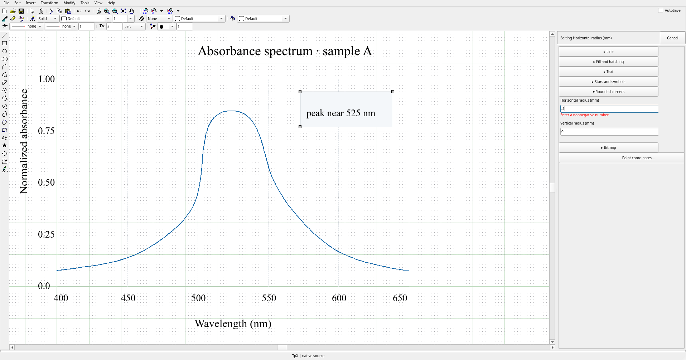
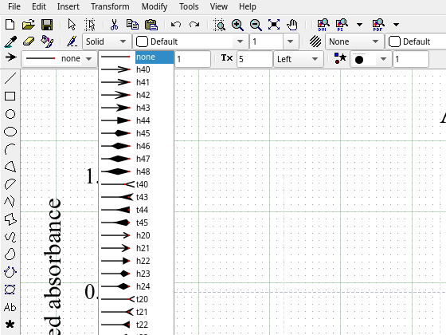
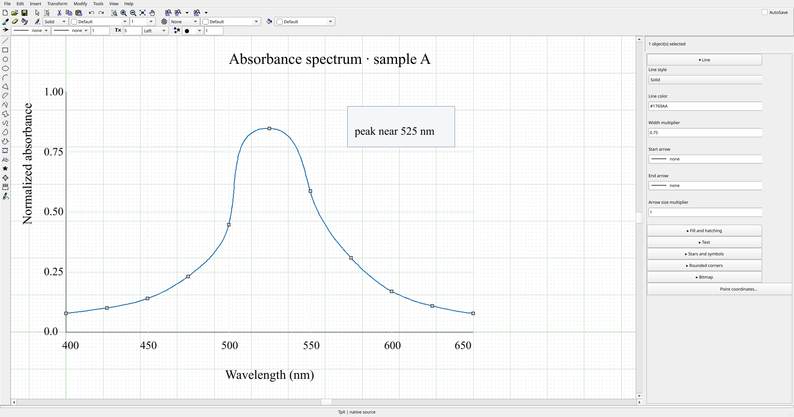
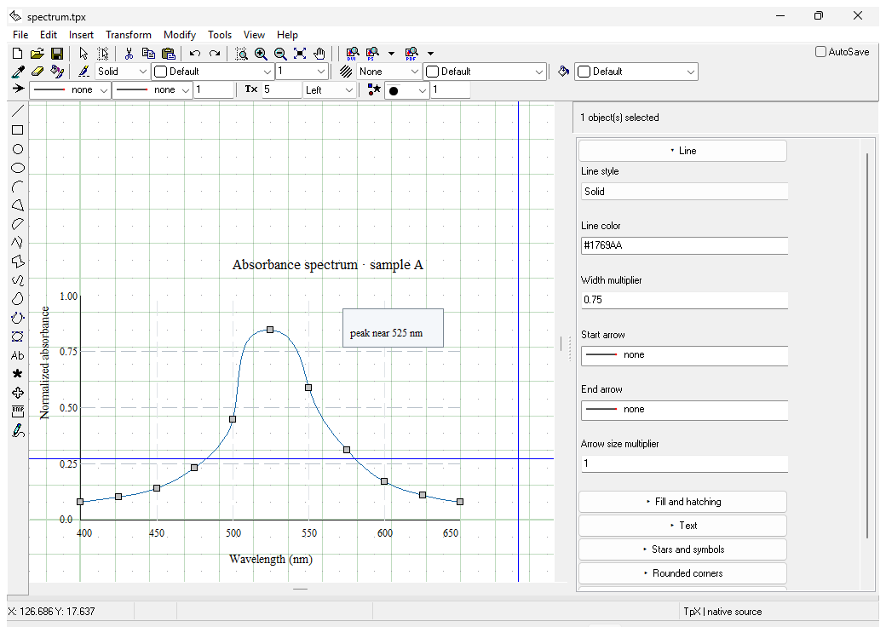
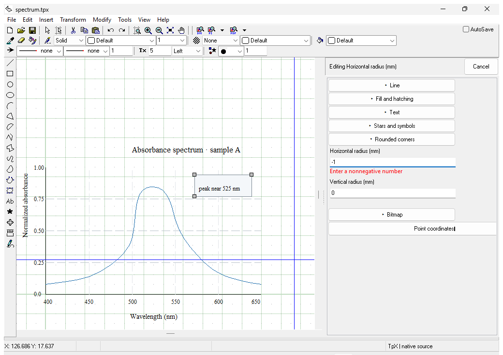

# Native Appearance Review

This review is for TpX maintainers deciding whether a later appearance implementation is warranted. The current evidence supports keeping Lazarus LCL controls and their compile-time widgetset styling, with a few focused follow-ups for visible contrast and scale behavior.

## Decision

Keep the existing LCL/widgetset model. GTK2, Qt6, Cocoa and Windows give standard controls their backend appearance, while TpX continues to draw its canvas and toolbar glyphs itself. A runtime palette or skin layer would add another source of colors, fonts and focus states without addressing the custom-drawn parts automatically.

The screenshots justify narrow follow-ups for a later implementation PR: improve custom toolbar glyph contrast on dark Cocoa, correct GTK2 control scaling at high DPI, and test Qt6 window fitting on 150% and 200% displays. Preserve the toolbar layout and native focus behavior. Defer runtime theme switching, a legacy appearance mode and a control-library migration.

## Capture method

The Cocoa, GTK2 and Qt6 images use #87 inspector candidate `3e4a81712bd0f055206a8e0a3404c4182e618818`. A scratch-only hook opens an authored absorbance-spectrum document through `BaseMode.OpenDocumentFromPath`, selects its curve, expands the Line inspector section, and sets a rounded-corner radius to `-1` for the validation image. The hook changes scenario state only; every image shows the real TpX window and native controls. The normal document session is active, with `TpX | native source` in the status bar. The #87 owner confirmed that the current `74dc8b8d9e37e7ec24b1669c7c25326137351ec9` candidate preserves the same inspector layout and visible captions; its nonvisual changes do not require repeating those screenshots.

Cocoa content was captured in-process from the AppKit view because external ScreenCaptureKit capture is blocked on this host. GTK2 and Qt6 images were captured from the application window on isolated Xvfb displays; menu images are crops of the actual open menu or toolbar dropdown. Windows images use a native Windows Server 2025 VM and are crops of the real TpX top-level window captured with `CopyFromScreen`; a scratch-only setup hook opens the spectrum document, selects its curve, expands Line properties, or enters `-1` in the radius field. The macOS appearance and display preferences were left unchanged, and the Windows display settings were queried but not changed. Capture hooks and raw variants remain in scratch space.

| Backend | Build and display | Observed result |
| --- | --- | --- |
| Cocoa | macOS 26.6.2 on M3 Ultra; native Dark appearance, 1920×1080 logical at 2× backing scale; FPC 3.2.3 and Lazarus 4.8 (`62c14a4d18c81f222127d42ce9b89b922c63fcbf`) | Native 2× window: 1916×987 logical, 3832×1974 captured pixels. No alternate display scale was forced. |
| GTK2 | GTK 2.24.33; FPC 3.2.2 and Lazarus 4.8 (`62c14a4d18c81f222127d42ce9b89b922c63fcbf`); Xvfb DPI 96/144/192 with the project’s default `Application.Scaled=False` | Window: 1916×1016 / 1916×1024 / 1916×1033. At 200%, GTK menu/status text grows while most toolbar and inspector controls stay near 100%; the second toolbar row clips. The window still fits 1920×1080, but control geometry does not scale consistently. |
| Qt6 | Qt 6.11.2 and Qt6Pas 6.2.10 built from the pinned Lazarus C bindings; FPC 3.2.2 and Lazarus 4.8 (`62c14a4d18c81f222127d42ce9b89b922c63fcbf`); `QT_SCALE_FACTOR=1/1.5/2` | Window: 1916×1006 / 2874×1508 / 3832×2012. At 150% and 200%, the full window exceeds a 1920×1080 display; larger virtual displays were used to capture it. |
| Windows | #87 head `74dc8b8d9e37e7ec24b1669c7c25326137351ec9`; Windows Server 2025 (10.0.26100) VM; FPC 3.2.2 and Lazarus 4.8; primary display 1024×768 at 96 LogPixels (current 100% setting). | Current display configuration only; 150% and 200% were not assessed. The maximized TpX window crop is 1040×736. |

The GTK2 150% and 200% runs use the real application defaults. A separate scratch-only run with `Application.Scaled=True` enlarged the whole form, but that setting is not enabled by the project and is excluded from the product findings. Qt’s scale factor is a controlled test setting; Qt recommends using native display settings for user-facing scale configuration in its [high-DPI guidance](https://doc.qt.io/qt-6.11/highdpi.html).

## Visual findings

The selected curve’s square handles and the inspector’s focused error field are visible in the tested light GTK2/Qt6 views, Dark Cocoa view and Windows view. Qt6 shows a blue focus border and red inline error text for the invalid radius; Windows shows its native blue focus underline and red inline validation text. The screenshots establish these cues in the sampled states, not keyboard traversal or assistive-technology behavior.

A single Qt6 keyboard probe found that Tab from the invalid radius kept focus on that field with the error visible. After correcting the value, Tab ended inline editing; the next focus target was not assessed.

Standard control surfaces, labels and menus follow the selected backend in the tested configurations. Control fonts inherit each backend’s default appearance; the canvas continues to use the fonts stored in the drawing. The GTK2 File menu and Qt6 arrow-style dropdown show distinct backend-rendered popup controls. TpX’s canvas, selection handles and toolbar glyphs remain application-drawn; the installed OS theme does not recolor them. On native Dark Cocoa, several existing toolbar glyphs are near-black against the dark toolbar surface, the clearest contrast issue in this sample. A focused icon-asset correction is justified for a later PR; a toolbar redesign is not.

The #87 candidate presents the Line heading before its property fields on all captured widgetsets. The absorbance plot, axis labels and selected curve remain readable with the inspector open. No global palette change or additional repaint path was needed for these views.

## Accessibility scope

These captures show selection, focus and error cues. Beyond the single Qt6 Tab probe described above, they do not assess keyboard navigation, shortcuts, screen-reader names, input-method composition, alternate high-contrast settings or every interactive control. Contrast ratios were not measured, so this review makes no WCAG conformance claim. [WCAG 2.2 text contrast](https://www.w3.org/WAI/WCAG22/Understanding/contrast-minimum.html) and [non-text contrast](https://www.w3.org/WAI/WCAG22/Understanding/non-text-contrast.html) are useful thresholds for a focused follow-up audit.

The Cocoa window capture excludes the system menu bar, and external screen capture was unavailable without changing host permissions. Windows was tested only at the existing 100% display setting; its 150% and 200% behavior remains unassessed. These platform gaps should be closed before claiming a full cross-platform accessibility or menu review.
